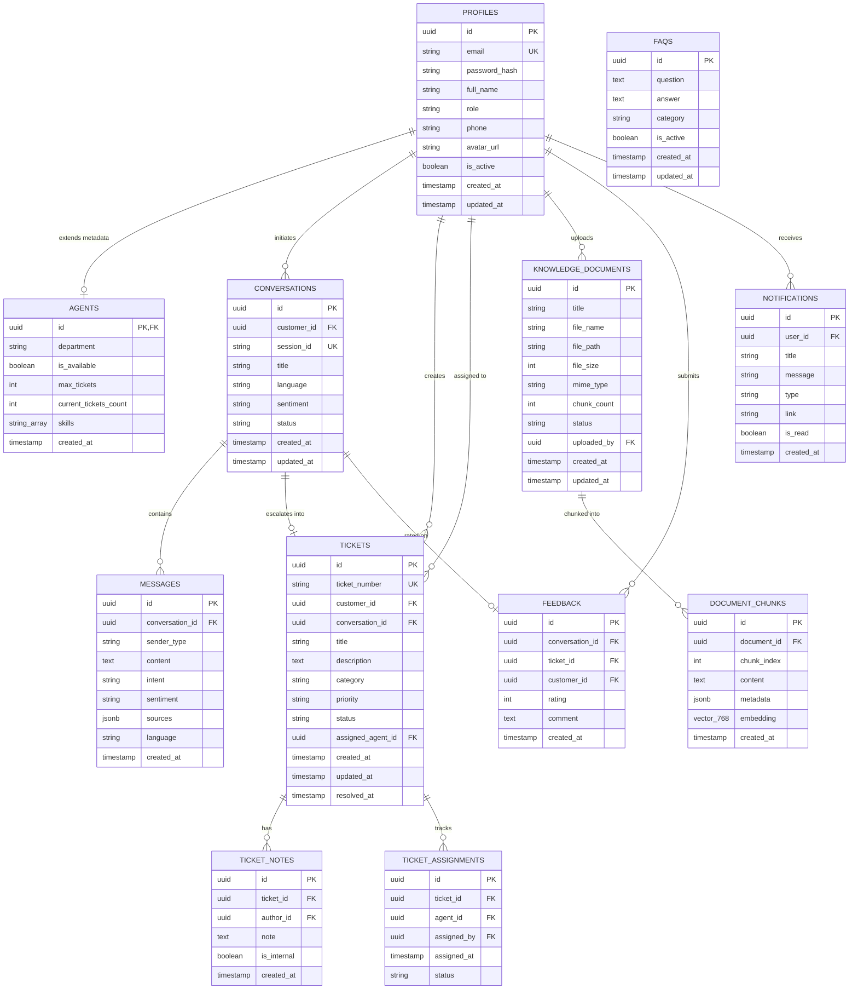

# Database Entity-Relationship Diagram (ERD) & Data Dictionary

This document provides the complete database model, entity relationships, and table schema definitions for the **AI-Powered Customer Support Agent** platform.

---

## 1. Entity-Relationship Diagram (ERD)

---

## 2. Table Data Dictionary

### `profiles`
| Column | Type | Constraints | Description |
| :--- | :--- | :--- | :--- |
| `id` | `UUID` | PK, Default `uuid_generate_v4()` | Unique user identifier |
| `email` | `VARCHAR(255)` | UNIQUE, NOT NULL | Account email address |
| `password_hash` | `VARCHAR(255)` | NOT NULL | Werkzeug scrypt/pbkdf2 hash |
| `full_name` | `VARCHAR(150)` | NOT NULL | User's legal name |
| `role` | `VARCHAR(20)` | `CHECK ('customer', 'agent', 'admin')` | Access control role |
| `phone` | `VARCHAR(30)` | NULL | Optional telephone contact |
| `avatar_url` | `VARCHAR(500)` | NULL | Profile image URI |
| `is_active` | `BOOLEAN` | DEFAULT TRUE | Account activity status |
| `created_at` | `TIMESTAMP` | DEFAULT CURRENT_TIMESTAMP | Registration timestamp |
| `updated_at` | `TIMESTAMP` | DEFAULT CURRENT_TIMESTAMP | Last profile modification |

### `tickets`
| Column | Type | Constraints | Description |
| :--- | :--- | :--- | :--- |
| `id` | `UUID` | PK | Unique internal ticket UUID |
| `ticket_number` | `VARCHAR(30)` | UNIQUE, NOT NULL | Human-readable identifier (`TIK-YYYYMMDD-XXXX`) |
| `customer_id` | `UUID` | FK -> `profiles(id)` | Customer who opened the ticket |
| `conversation_id`| `UUID` | FK -> `conversations(id)`, NULL | Linked chat transcript if escalated |
| `title` | `VARCHAR(250)` | NOT NULL | Issue summary |
| `description` | `TEXT` | NOT NULL | Detailed problem statement |
| `category` | `VARCHAR(50)` | `CHECK ('BILLING', 'TECHNICAL', ...)` | Departmental category |
| `priority` | `VARCHAR(20)` | `CHECK ('LOW', 'MEDIUM', 'HIGH', 'URGENT')` | Urgency classification |
| `status` | `VARCHAR(20)` | `CHECK ('OPEN', 'IN_PROGRESS', ...)` | Ticket lifecycle state |
| `assigned_agent_id`| `UUID` | FK -> `profiles(id)`, NULL | Current handling agent |
| `resolved_at` | `TIMESTAMP` | NULL | Resolution completion timestamp |

### `document_chunks`
| Column | Type | Constraints | Description |
| :--- | :--- | :--- | :--- |
| `id` | `UUID` | PK | Unique chunk ID |
| `document_id` | `UUID` | FK -> `knowledge_documents(id)` | Parent PDF document |
| `chunk_index` | `INTEGER` | NOT NULL | Sequential chunk order in PDF |
| `content` | `TEXT` | NOT NULL | Extracted passage text |
| `metadata` | `JSONB` | DEFAULT `{}` | Page number, section, title |
| `embedding` | `vector(768)` | pgvector cosine indexing (HNSW) | 768-dim Gemini vector |
