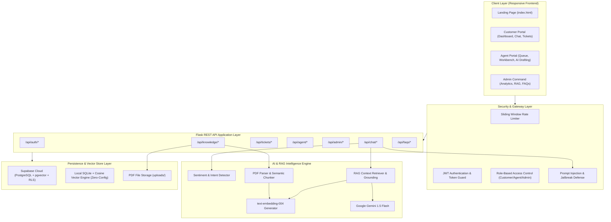
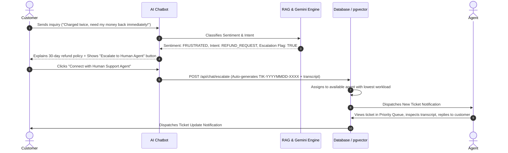

# System Architecture: AI-Powered Customer Support Agent

This document outlines the end-to-end architecture, component interactions, security layers, and data pipelines for the **AI-Powered Customer Support Agent** platform.

---

## 1. High-Level Architecture Diagram

---

## 2. Component Breakdown

### 2.1 Client Layer
- **Responsive HTML5 / CSS3 / Vanilla JavaScript**:
  - Implements a modern SaaS design system utilizing a dark navy (`#0A192F`) and slate blue theme with high contrast, crisp typography, and responsive grid layouts.
  - Divided into 12 dedicated pages across three core roles: **Customer**, **Support Agent**, and **Administrator**.
  - Centralized API fetch client with automatic JWT bearer injection, refresh error interceptors, and non-blocking toast notifications.

### 2.2 Security & Gateway Layer
- **Sliding Window Rate Limiter**: Protects sensitive endpoints (chat generation, ticket submission, login) against brute-force and resource exhaustion.
- **JWT Authentication & RBAC**: Stateless signed JSON Web Tokens (HS256) with strict role authorization (`@role_required(["admin"])`, `@role_required(["agent", "admin"])`).
- **Prompt Injection Defense**: Evaluates incoming customer queries against regex patterns detecting jailbreak attempts (`ignore previous instructions`, `DAN mode`, `reveal system prompt`, etc.) before passing to the AI pipeline.

### 2.3 AI & RAG Pipeline
1. **Document Ingestion**:
   - PDF documents are uploaded via the Admin portal (`/api/knowledge/upload`).
   - `PDFService` extracts raw text page-by-page.
   - Text is partitioned into overlapping semantic chunks (600 characters with 100 character overlap) to preserve sentence boundaries.
   - `EmbeddingService` generates 768-dimensional embeddings using Gemini `text-embedding-004` (or local deterministic unit-vector projections in offline mode).
   - Chunks and embeddings are stored in Supabase `document_chunks` with HNSW vector indexing.
2. **Context Retrieval**:
   - Customer messages are embedded into the same 768-dimensional vector space.
   - Vector similarity search retrieves top-$k$ nearest chunks using cosine distance ($1 - \text{cosine\_dist}$).
   - Active FAQs with keyword overlap are appended to provide supplementary official answers.
3. **Grounded Generation (Anti-Hallucination)**:
   - System prompt instructs Gemini strictly to ground answers in retrieved context.
   - Explicitly barred from committing to refunds or fabricating customer transaction data.
   - Sources are tagged and sent with the response for citation display.

---

## 3. Support Ticket Escalation Flow

